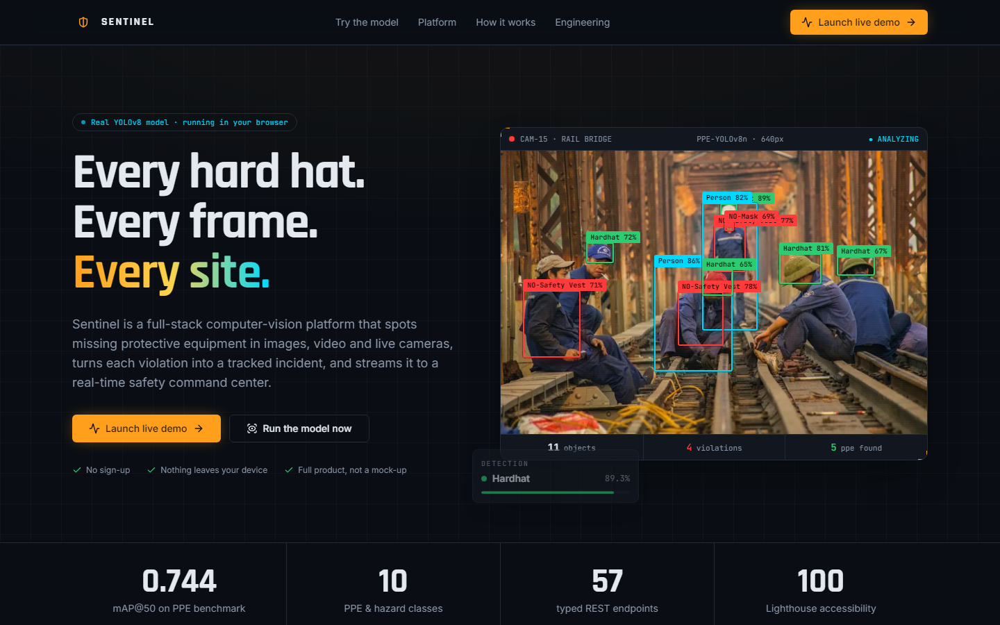
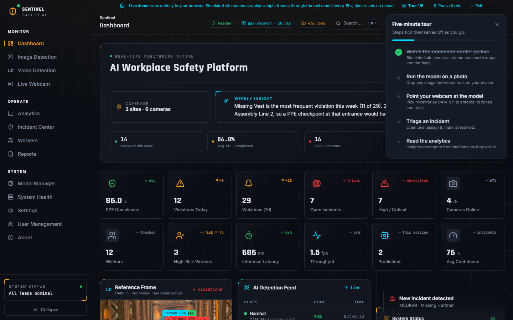
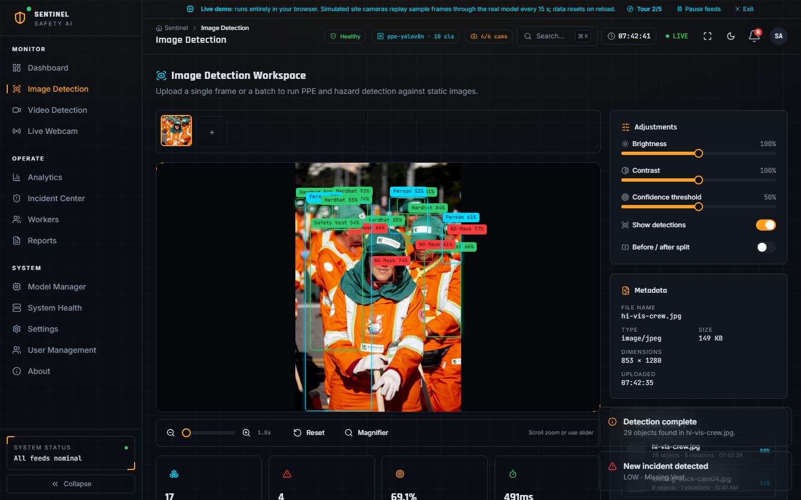
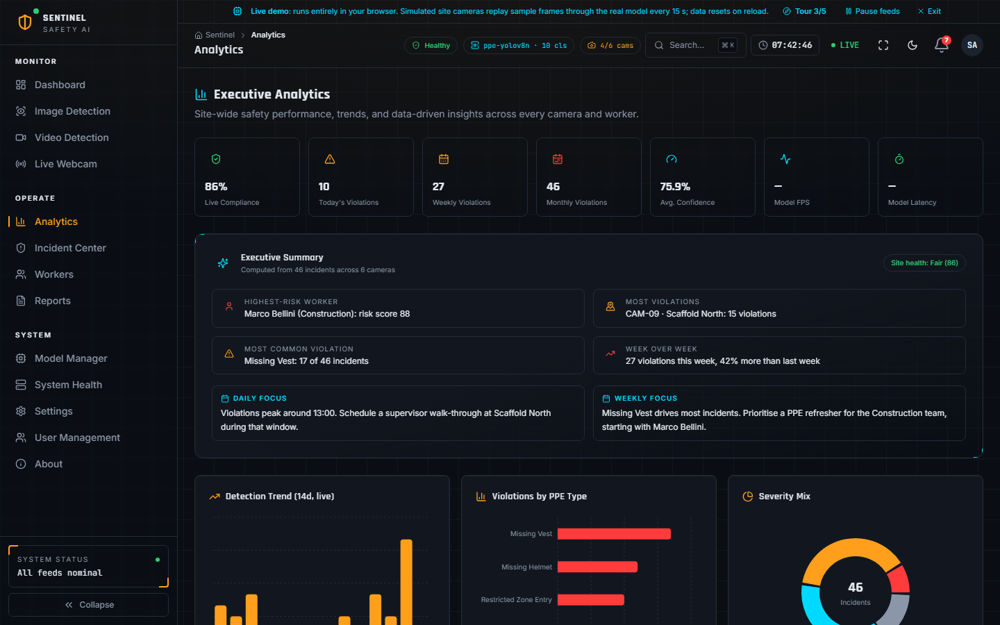
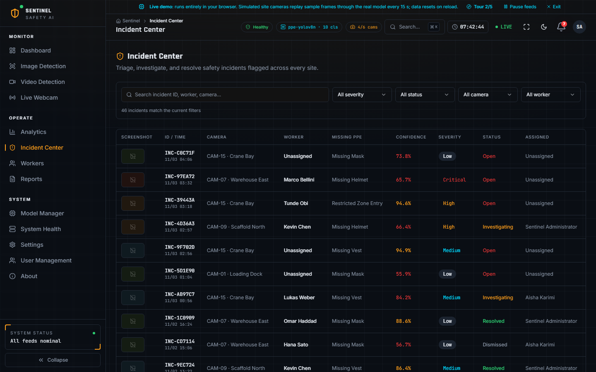
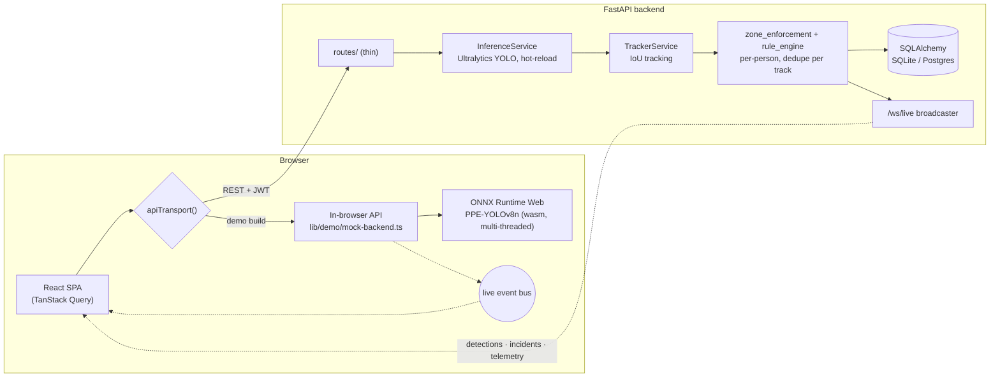

<div align="center">


# Sentinel

**Computer-vision workplace safety platform: detects missing PPE in images, video and live cameras, turns each violation into a tracked incident, and streams it to a real-time command center.**

[**Live demo**](#live-demo) · [Run locally](#getting-started) · [Architecture](#architecture) · [Engineering highlights](#engineering-highlights)




</div>

## Live demo

> **[▶ Open the live demo](#)** (no sign-up, nothing to install)
> <sub>Replace `#` with your deployment URL. See [Deploying](#deploying).</sub>

The public demo is a static site, yet nothing in it is faked. The production
detection model is exported to ONNX and runs **in your browser** with
WebAssembly, and a typed in-browser implementation of the REST API stands in
for the server. You can:

1. **Run the model** on sample photos, your own image, or your **webcam**, right on the landing page.
2. Click **Launch live demo** to get the full product: dashboard, incident triage, video analysis, live webcam monitoring, analytics, reports and admin.
3. Follow the **five-minute tour** in the demo banner. Steps tick themselves off from real activity, and simulated site cameras keep the command center streaming (sample frames replayed through the real model every 15 s, clearly labelled and pausable).

## What it does

| | |
|---|---|
| **Detect** | YOLOv8 PPE model (hard hats, vests, masks, people, machinery, plus their `NO-*` violations) across **images, uploaded video and live webcam** through a single inference service. |
| **Track** | Class-aware IoU tracking assigns stable IDs, so one worker missing a hard hat for 300 frames creates **one** incident, not 300. |
| **Enforce** | Polygon zones per camera (mandatory-PPE, restricted, danger) plus site-wide rules. Each person is checked against the PPE **they** are wearing (spatial association), in the zone **they** stand in. |
| **Act** | Violations become severity-ranked incidents with evidence screenshots, assignment and resolution workflow, pushed live over a WebSocket to every open dashboard. |
| **Understand** | Compliance KPIs, violation trends, worker risk ranking, camera hot-spots and rule-based weekly insights, all computed from live data. |
| **Govern** | JWT auth (access + refresh), 4 RBAC roles, user management, full audit trail, CSV / Excel / PDF reports. |

<table>
  <tr>
    <td></td>
    <td></td>
  </tr>
  <tr>
    <td align="center"><sub>Command center: every widget reads live API data</sub></td>
    <td align="center"><sub>Image detection: boxes, confidences, export</sub></td>
  </tr>
  <tr>
    <td></td>
    <td></td>
  </tr>
  <tr>
    <td align="center"><sub>Analytics: insights derived from incidents, not canned text</sub></td>
    <td align="center"><sub>Incident center: filter, triage, assign, resolve</sub></td>
  </tr>
</table>

## Architecture



The frontend never knows which backend it's talking to. Every request goes
through a single `apiTransport()` ([`src/lib/auth.ts`](src/lib/auth.ts)):
in a normal build it's `fetch`, in the demo build it's an in-browser router
that returns the **same response shapes** as the Pydantic schemas. Live events
follow the same `{type, payload, ts}` envelope whether they come from the
WebSocket or the in-process bus.

## Engineering highlights

The parts most worth reading:

- **In-browser YOLO inference:** [`src/lib/vision/detector.ts`](src/lib/vision/detector.ts) and [`yolo-postprocess.ts`](src/lib/vision/yolo-postprocess.ts). Letterboxing, decoding the raw `[1, 14, 8400]` head, per-class NMS and mapping back to source coordinates, all hand-written and unit-tested. The model and runtime load lazily, so the landing page never pays for them up front.
- **One rulebook, two languages:** violation classification lives in [`ppe_incident_rules.py`](backend/app/services/ppe_incident_rules.py) and is mirrored in TypeScript, with tests on both sides asserting the same mapping.
- **Zone enforcement with spatial association:** [`zone_enforcement.py`](backend/app/services/zone_enforcement.py) resolves each tracked person's zone (ray-casting point-in-polygon) and attributes PPE by box geometry. Writing it surfaced two latent bugs, both now covered by regression tests: a hard hat *anywhere* in frame used to satisfy *everyone*, and site-wide rules were silently skipped during evaluation. A TypeScript mirror powers the demo and is held to the same test fixtures.
- **Incident deduplication:** violations are keyed by `(track, zone, violation)` across frames, which is what makes video and webcam usable in practice.
- **Single shared WebSocket:** [`LiveChannelProvider`](src/providers/LiveChannelProvider.tsx) owns one connection per session with exponential-backoff reconnect and fans events out to subscribers. A live incident invalidates exactly the dashboard queries that depend on it.
- **Auth that degrades gracefully:** silent access-token refresh with a single retry, then a clean logout. The API **refuses to boot in production** with a weak JWT secret, the default admin password, `DEBUG` on, or wildcard CORS ([`config.py`](backend/app/core/config.py)).
- **Hot-swappable models:** drop any Ultralytics checkpoint at `backend/models/best.pt`; it's reloaded on the next request with no restart, and class names are read from the weights.
- **Performance budget:** route-level code splitting plus precise vendor chunking keep charts (117 kB gz) and every product page off the landing page's critical path. Cross-origin isolation headers enable multi-threaded WASM.
- **Measured, not claimed:** Lighthouse desktop 95 performance and 100 accessibility / best practices / SEO (self-hosted fonts, responsive WebP, labelled controls); inference latency excludes the one-off model download.
- **Honest data:** no dashboard number is hard-coded. KPIs, insights and report summaries are derived from incidents ([`src/lib/incident-stats.ts`](src/lib/incident-stats.ts), tested).

## Tech stack

| Layer | Tools |
|---|---|
| Frontend | React 19, TypeScript, Vite, TanStack Query, React Router, Tailwind CSS + Radix UI (shadcn), Framer Motion, Recharts |
| Backend | FastAPI, SQLAlchemy 2, Pydantic v2, Alembic, WebSockets, python-jose (JWT), passlib/bcrypt, reportlab, openpyxl |
| Computer vision | Ultralytics YOLOv8, OpenCV, ONNX, onnxruntime-web |
| Quality | pytest, Vitest, Playwright, ESLint, `tsc --strict`, GitHub Actions |
| Delivery | Docker Compose, nginx, Vercel |

## Getting started

### Frontend only (demo mode, 1 minute)

```bash
npm install
npm run dev          # http://localhost:5173 → "Launch live demo"
```

### Full stack

Prerequisites: Node 20+, Python 3.11+.

```bash
# backend
cd backend
python -m venv .venv
source .venv/bin/activate          # Windows: .venv\Scripts\activate
pip install -r requirements.txt
uvicorn app.main:app --reload --port 8000     # API docs at /docs

# frontend (new terminal, repo root)
npm install
npm run dev                         # http://localhost:5173/login
```

On first start the backend creates its SQLite schema and seeds an admin
(`admin` / `ChangeMe123!`, forced to change on first login) plus sample
cameras, workers, zones and rules. Or run everything with
`docker compose up --build`.

## Testing

```bash
cd backend && pytest       # 76 API, service, tracking and zone-enforcement tests
npm test                   # 22 Vitest: YOLO decoding, NMS, violation & zone rules, analytics
npm run test:e2e           # 7 Playwright: landing, in-browser inference, live feeds, tour, every page
npm run lint && npm run typecheck
```

[CI](.github/workflows/ci.yml) runs all of the above on every push. The
Playwright suite runs against the production demo build with production
headers, so it exercises real model inference in headless Chromium.

## The model

| Metric (validation) | Value |
|---|---|
| mAP@0.50 | 0.744 |
| mAP@0.50:0.95 | 0.436 |
| Precision / Recall | 0.831 / 0.685 |

Pretrained YOLOv8n from [`Hansung-Cho/yolov8-ppe-detection`](https://huggingface.co/Hansung-Cho/yolov8-ppe-detection)
(MIT), chosen after comparing alternatives
([report](ml/PRETRAINED_MODEL_REPORT.md)). Classes: `Hardhat`, `Mask`,
`NO-Hardhat`, `NO-Mask`, `NO-Safety Vest`, `Person`, `Safety Cone`,
`Safety Vest`, `machinery`, `vehicle`. A full pipeline for merging datasets
and fine-tuning your own model lives in [`ml/scripts`](ml/scripts)
(numbered `01`–`10`).

## Deploying

- **Static demo:** import the repo into Vercel. [`vercel.json`](vercel.json) handles the build, SPA routing and isolation headers. Details in [docs/DEPLOYMENT.md](docs/DEPLOYMENT.md).
- **Full stack:** `docker compose up --build`; production checklist in the same guide.

## Known limitations

- Zone enforcement runs on live webcam sessions bound to a site camera ("Monitor as CAM-…"); uploaded video still uses the always-on PPE rules.
- The bundled model doesn't detect goggles, gloves or boots, and can mistake caps for hard hats at a distance.
- Settings are held in memory on the server; SQLite is used by default (Postgres-ready via SQLAlchemy).
- In demo mode, PDF/Excel export and annotated video re-encoding are server-only; CSV export and video timeline analysis work in the browser.

## Repository map

```
src/                React app (pages/, components/, lib/vision for in-browser CV, lib/demo for the mock API)
backend/app/        FastAPI: api/routes → services → models / schemas, websocket/
backend/tests/      pytest suite
ml/scripts/         dataset merge → validate → dedupe/split → train → evaluate → export
e2e/                Playwright tests (+ screenshot generator for this README)
docs/               deployment, demo guide, structure, audit log
```

Full breakdown: [docs/PROJECT_STRUCTURE.md](docs/PROJECT_STRUCTURE.md).

## Credits

Sample photography from [Pexels](https://www.pexels.com/) (Pexels License).
Detection checkpoint by [Hansung-Cho](https://huggingface.co/Hansung-Cho/yolov8-ppe-detection) (MIT).

## License

[MIT](LICENSE). Third-party model weights and sample images keep their own licenses, listed under Credits.
